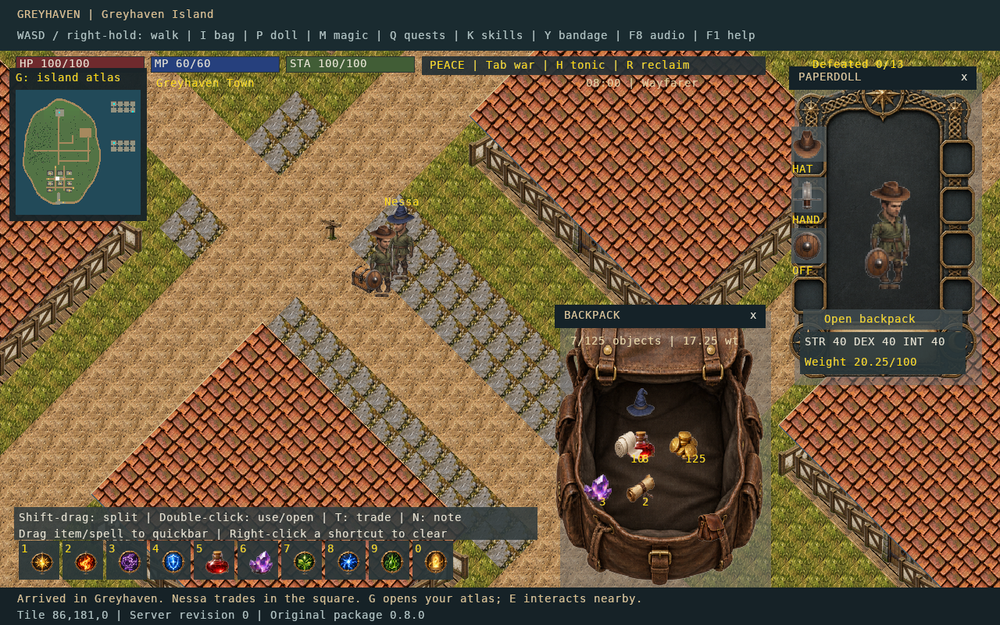
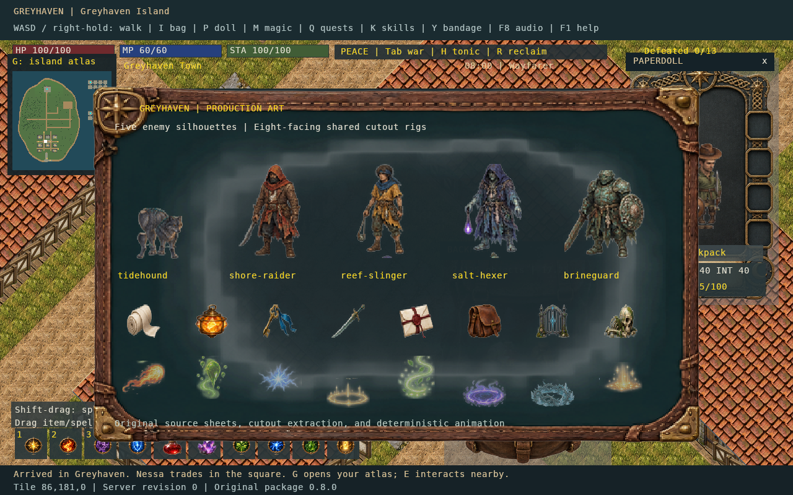
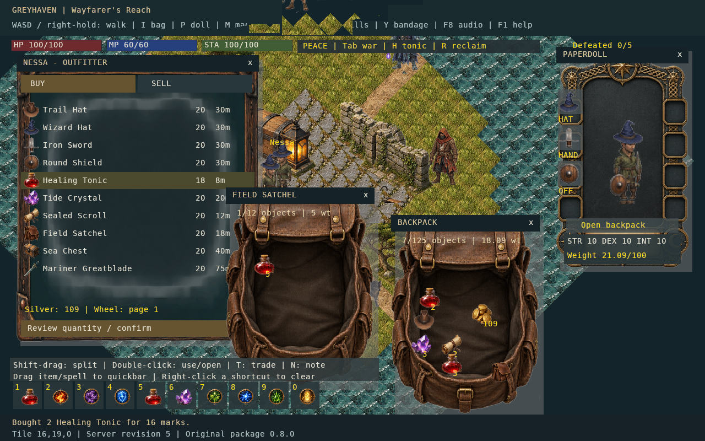
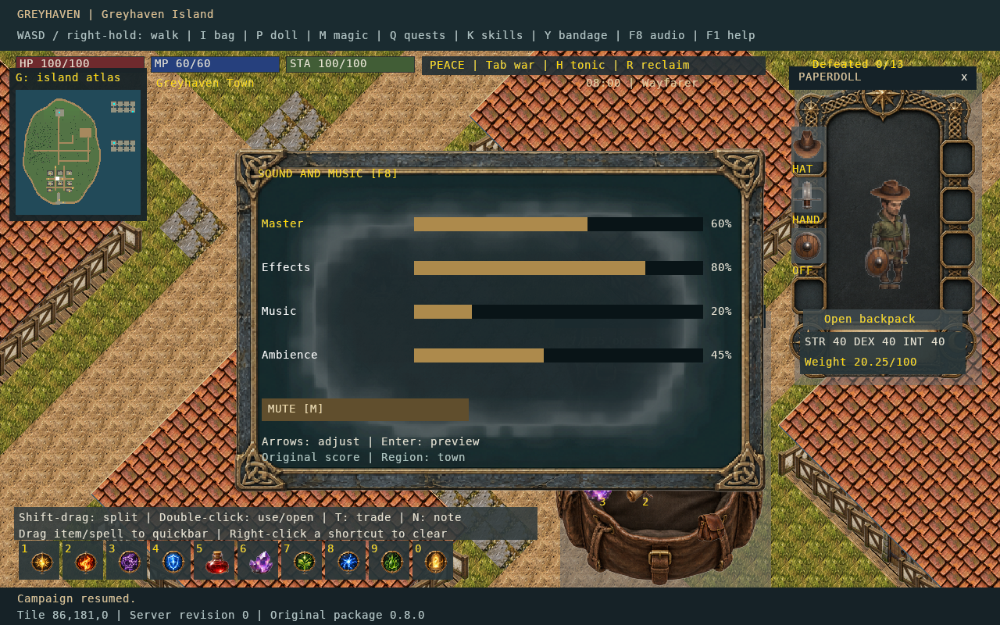

# Greyhaven

**An original single-player, 2D island RPG with exploration, quests, combat, inventory systems, and an in-game world editor.**

> **Preview release · v0.8.0 · Windows x64**  
> This is a playable development milestone, not a final or fully certified release. A Windows build is included, but it was cross-published; clean-machine Windows runtime testing has not been confirmed. **Co-op/multiplayer is not available in this preview.**

## Play the game

1. Open the repository's **Releases** page and download **`Greyhaven-v0.8.0-preview-Windows-x64.zip`** (not GitHub's automatically generated source archive).
2. Extract **the entire ZIP** into a normal writable folder such as `Games\Greyhaven`; do not launch from inside the ZIP.
3. Double-click **`Run-Greyhaven.cmd`**. Choose a campaign slot and start a new game.
4. Your launcher starts a local game server, opens the game client, and saves progress through the campaign system. No separately installed .NET SDK, Ultima Online client, or proprietary game data is required.

**Also included:** `Map-Editor.cmd` for the world workshop, `Play-Edited-Map.cmd` for exported maps, and `Start-Media-Preview.html` for an offline art/sound sampler. The sampler is optional, not the game.

[Full player guide](docs/PLAYER_GUIDE.md) · [Troubleshooting](docs/TROUBLESHOOTING.md) · [Controls](#controls) · [Release notes](CHANGELOG.md)

## Explore Greyhaven Island

- **Explore** a handcrafted 256 × 256 island with a town, coast, woods, marsh, a lighthouse/beacon, and an interconnected two-level dungeon.
- **Adventure** through a principal quest, three side quests, conversations with residents, discoveries, containers, traps, and encounters.
- **Fight and cast** using melee attacks, spells, consumables, a paperdoll, a spellbook, and a ten-slot quickbar.
- **Manage** physical inventory, nested containers, equipment, merchant trades, saved journals, and campaign progression.
- **Customize** terrain and objects with the included map editor, then export and test the resulting island map.
- **Listen** to 39 synthesized sound cues, including ambience and regional music. Use **F8** to adjust effects, music, ambience, and master volume.
- **Save** across three campaign slots with explicit saves, quick saves, autosaves, and backups.

### Screenshots

| Island and inventory | Creatures and visual effects |
| :---: | :---: |
|  |  |

| Equipment and inventory | Music and audio interface |
| :---: | :---: |
|  |  |

## Controls

| Action | Key / input |
|---|---|
| Walk | WASD, arrow keys, or right-mouse hold |
| Interact | E or double-click a nearby object |
| Inventory / paperdoll / spellbook | I / P / M |
| Island atlas / journal / quests / skills | G / J / Q / K |
| Attack / war mode | Space / Tab |
| Quick save / quick load | F5 / F9 |
| Audio settings | F8 |
| Pause / cancel target | Esc |
| Bandage / recovery | Y / R |
| Map editor tools | F2 palette, F4 properties, F6 playtest, F7 validation |

Additional bindings and item-drag interactions are in the [player guide](docs/PLAYER_GUIDE.md). The game also displays control hints during play.

## Current status

This package corresponds to the project's **Phase 8 art and audio milestone**. It is an independent-content single-player prototype. Phase 9 co-op and Phase 10 release certification are **not included**. The shipped Windows executables were cross-published; some native simulation/rendering checks were exercised on Linux, but clean-machine Windows gameplay certification remains outstanding.

Please file reproducible issues using the [bug report template](.github/ISSUE_TEMPLATE/bug_report.yml). Avoid attaching personal save data, credentials, or identifiable logs to public issues.

## Build from source

The repository contains the original project and required pinned dependency source trees, including covered upstream code. The **Windows download is the player build**, while this GitHub repository is the developer/source tree.

- Requirements: **.NET SDK 10.0.402**, Python **3.10+**; Windows x64 is the primary release target. Some original upstream fork build commands require the .NET Framework 4.8 Developer Pack and Git.
- `python tools/project.py verify` checks bundled source snapshot/dependency integrity.
- `python tools/project.py original-build` builds Greyhaven's original client, editor, server, and launcher.
- `python tools/project.py content-check` runs C# content/inventory/combat/world/adventure suites.
- `python tools/project.py runtime-publish` creates the self-contained Windows programs in `Runtime/`.
- Content/audio and artwork rebuilds use Python + Pillow and the programs in `tools/art/` and `tools/content/`.

See the [build instructions](docs/BUILDING_FROM_SOURCE.md). The repository does not commit generated self-contained Windows binaries or local player saves; those are in the release download / user machine respectively.

## License and third-party credits

Copyright (c) 2026 **Michael Robinson** for the original project code described in [LICENSE](LICENSE). The repository is **not uniformly MIT licensed**: ServUO-related/server components are GPL-covered; preserved upstream TazUO/CentrED/FNA/.NET libraries retain their own licenses and notices. Original game art, writing, soundtrack, maps and other game content do **not** yet have an explicit public reuse license. No permission to reuse those assets independently is implied by the code license.

See [license boundaries](LICENSE-BOUNDARIES.md) and [distribution notices](docs/CREDITS_AND_LICENSES.md). The Windows archive includes third-party notices and the source tree/associated release tag provides corresponding server source. A final legal/licensing review is still needed before a wider public release.
